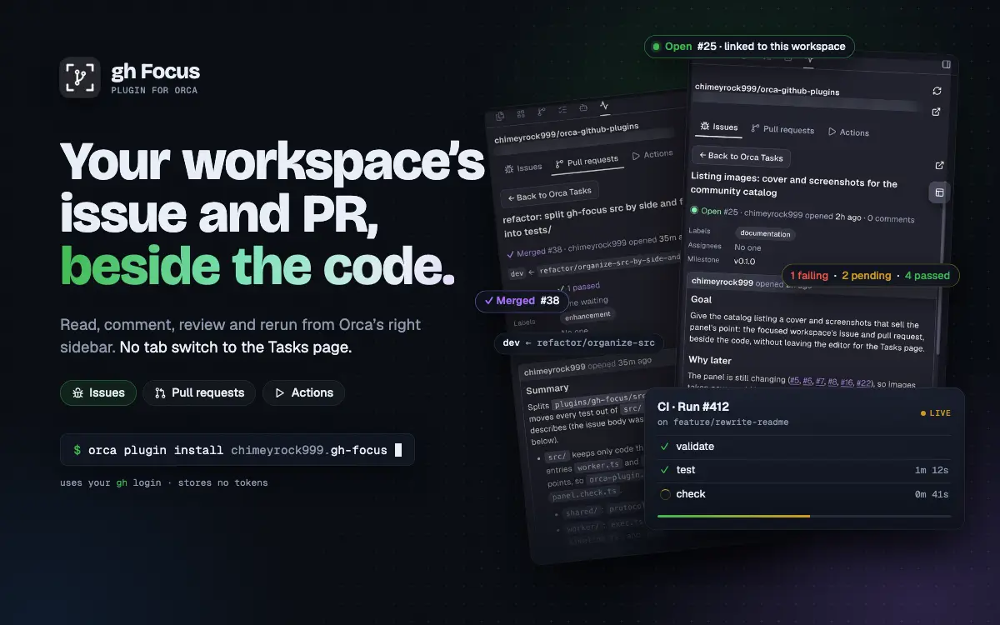
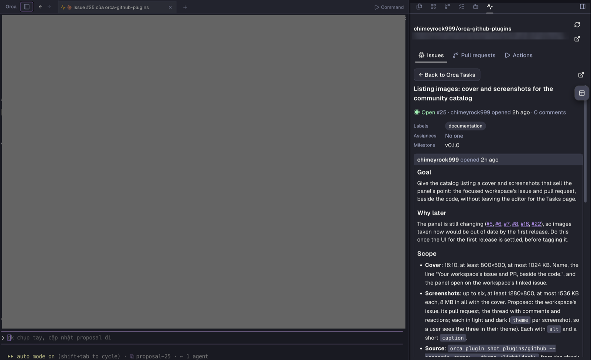
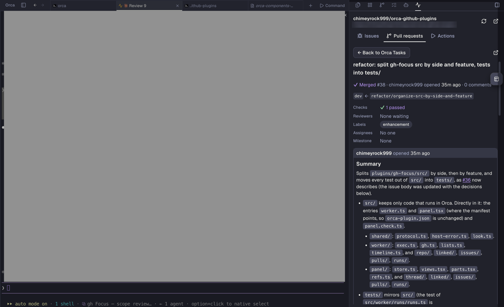
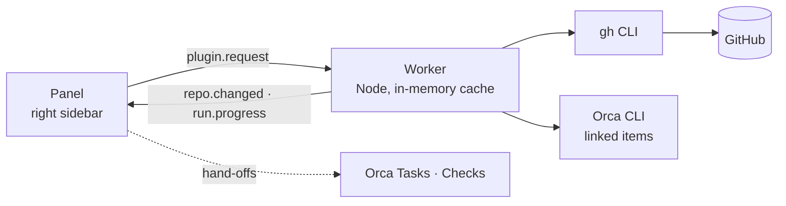

<div align="center">



<p><a href="https://github.com/chimeyrock999/orca-github-plugins/tags"></a>  <a href="https://cli.github.com"></a>  <a href="LICENSE"></a></p>

<p><a href="#install">Install</a> · <a href="#what-you-get">What you get</a> · <a href="#what-stays-in-orca">What stays in Orca</a> · <a href="#how-it-works">How it works</a> · <a href="#permissions">Permissions</a> · <a href="#develop">Develop</a> · <a href="https://orca.dev/plugins/chimeyrock999/orca-github-plugins">Plugin page</a></p>

</div>

gh Focus is a plugin for [Orca](https://github.com/stablyai/orca). It puts a panel in the right sidebar that follows the focused workspace: the issue Orca links to it, its pull request and its branch's Actions runs. You read and answer them beside the code; the detail work (merge, reviewers, the files diff, Projects) stays on Orca's own pages, and the panel hands off to them.

> [!NOTE]
> gh Focus is not affiliated with GitHub. Every GitHub call goes through the [`gh` CLI](https://cli.github.com) already logged in on your machine; the plugin holds no tokens of its own.

## Install

[**Open in Orca →**](https://orca.dev/plugins/chimeyrock999.gh-focus?catalog=community)

Or in Orca: **Settings → Plugins**, community catalog, **gh Focus**. Or from a terminal:

```sh
orca plugin install chimeyrock999.gh-focus
```

Orca asks you to approve the [permissions](#permissions) first; an update that adds one asks again.

**Needs**

- Orca `1.4.256` or later.
- `gh`, logged in (`gh auth login`) with access to the repo.
- A workspace whose folder is a clone of a GitHub repo.
- Orca's own CLI, which tells the plugin what Orca links to a workspace. On macOS it ships in the app; on Linux and Windows, put `orca` on PATH.

## What you get

Three tabs, each about the workspace in focus. Switch workspace and the panel follows.

| Tab | What it shows | What you can do |
| :--- | :--- | :--- |
| **Issues** | The issues Orca links to the workspace: one opens by itself, several make a short list. One of another repo opens here too. | Comment, edit or delete comments, react, close (completed, not planned, duplicate) or reopen, edit the title, body, labels and assignees. |
| **Pull requests** | The workspace's pull request (linked in Orca, or the branch's), with its review decision, whether it can merge, and one line for its checks. | Comment, react, edit, review (Comment, Approve, Request changes), Ready for review or Convert to draft. |
| **Actions** | The runs of the workspace's branch, or every branch, with search and filters, and live updates while a run goes. | Open jobs and steps with failed logs already open, rerun or cancel, approve a waiting deployment, see artifacts, Run workflow with its inputs. |

<table>
  <tr>
    <td width="50%"></td>
    <td width="50%"></td>
  </tr>
  <tr>
    <td align="center"><sub>The workspace's issue, beside your work</sub></td>
    <td align="center"><sub>Its pull request: branches, checks and review</sub></td>
  </tr>
</table>

**Nothing linked yet?** The panel shows the `orca reference add` command that links an issue to the workspace, and **Ask agent** types that request into the workspace's free agent, without pressing Enter, so you read it and send it. While the agent works or waits on a question, the panel names it and offers Ask agent by itself once it stops.

**Light on your GitHub budget.** The panel shares the budget with Orca, so answers are kept in memory for a short while, an unchanged REST answer costs nothing (ETag), and a write drops only what it changes. When the budget runs low the panel reads less often and says so.

## What stays in Orca

gh Focus is small on purpose: it does not rebuild what Orca already does well. It hands off instead.

| You want | Where it goes |
| :--- | :--- |
| The repo's issue and pull request lists, search, a new issue | **← Tasks** opens Orca's Tasks page |
| Review threads on the diff, check logs and reruns | **Open in Checks** opens Orca's Checks tab, which opens a comment's file at its line |
| Merge, reviewers, the files diff, stacks, Projects | Orca's pull request page |
| Anything else | **Open on GitHub** |

## How it works



The panel asks, the plugin's own worker answers and runs `gh` in the workspace's folder. Nothing is written to disk but the workspace you picked when Orca cannot tell which one is focused.

## Permissions

gh Focus is a `trusted-worker`: its worker runs `gh` and Orca's CLI on your machine with your user's access.

| Permission | Why |
| :--- | :--- |
| `storage:own` | Remembers which workspace you picked when Orca cannot tell which one is focused. |
| `workspace:read` | The focused workspace's name, branch and terminals, to find its folder and repo. |
| `workspace:write` | Only to open Orca's Tasks page and Checks tab; it never opens, creates or renames a workspace. |
| `agent:read` | Finds a free agent of the workspace for Ask agent, and notices when an agent starts or stops. |
| `terminal:send` | Types the link request into that agent's terminal, without pressing Enter. |

Every feature, the panel in detail and the files behind it: [`plugins/gh-focus/README.md`](plugins/gh-focus/README.md).

## Develop

Needs Orca `1.4.256`+ with its `orca` CLI on PATH, Node.js 18+, and `gh` logged in.

```sh
cd plugins/gh-focus
orca plugin types .        # typings, needed before tsc
npm install
orca plugin validate .
orca plugin test .
orca plugin check .
npx tsc -p .
orca plugin dev watch .    # load into Orca with live reload
```

All four checks (validate, test, check, tsc) pass before a pull request; pull requests go into `dev`. There is no build step: Orca transpiles the panel and worker when they load. More in [`plugins/gh-focus/README.md`](plugins/gh-focus/README.md#develop) and [`CLAUDE.md`](CLAUDE.md).

<details>
<summary><b>Repo layout</b></summary>

| Path | What |
| :--- | :--- |
| [`plugins/gh-focus/`](plugins/gh-focus) | gh Focus (`gh-focus`), a `trusted-worker` with one components panel |
| `plugins/gh-focus/src/` | The worker and panel entries, then `shared/`, `worker/` and `panel/` by feature |
| `plugins/gh-focus/tests/` | Tests at the same paths as the files they test; `gh` is always faked |
| [`docs/cover/`](docs/cover) | The cover's source; `render.sh` draws the catalog cover and the README's animated one |
| [`CHANGELOG.md`](CHANGELOG.md) | What changed in each version |
| [`RELEASING.md`](RELEASING.md) | How to cut a release or a hotfix, and retake the listing images |

</details>

## Releases

What changed in each version: [`CHANGELOG.md`](CHANGELOG.md). How to cut a release or a hotfix: [`RELEASING.md`](RELEASING.md).

## License

[MIT](LICENSE)
